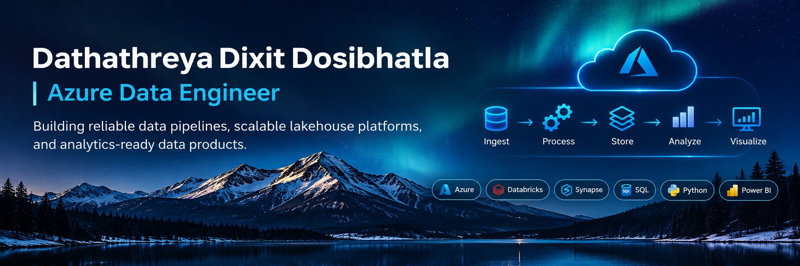

 

  

# Dathathreya Dixit Dosibhatla

### Azure Data Engineer

**Building reliable data pipelines, scalable lakehouse platforms, and analytics-ready data products.**

[LinkedIn](https://www.linkedin.com/in/dathathreya-dixit/) · [GitHub](https://github.com/dixitdosibhatla)

---

## Navigation

[About](#about) · [Technical Expertise](#technical-expertise) · [Featured Projects](#featured-projects) · [Engineering Interests](#engineering-interests) · [Connect](#connect)

---

## About

I am an Azure Data Engineer focused on building scalable, reliable, and maintainable data platforms.

My work focuses on designing end-to-end data pipelines, developing lakehouse architectures, and transforming complex source data into analytics-ready datasets.

I enjoy solving practical engineering problems, understanding architectural trade-offs, and building data solutions that address real-world business requirements.

---

## Technical Expertise

**Cloud & Data Platforms**

- **Azure Data Factory:** Pipeline orchestration, linked services, datasets, integration runtimes, parameterized pipelines, metadata-driven ingestion, and incremental loading.
- **Azure Data Lake Storage Gen2:** Data lake organization, storage layers, and working with structured and semi-structured data.
- **Azure Synapse Analytics:** Serverless SQL pools, querying external data using `OPENROWSET`, working with Parquet files, and `COPY INTO`.
- **Azure DevOps:** Git integration, source control, and deployment workflows.

**Data Engineering & Processing**

- **Azure Databricks:** Notebook development, Spark-based transformations, and lakehouse implementation.
- **Apache Spark & PySpark:** DataFrame operations, joins, aggregations, filtering, transformations, and distributed data processing.
- **Delta Lake:** ACID transactions, schema enforcement, schema evolution, and reliable data storage.
- **Medallion Architecture:** Organizing data into Bronze, Silver, and Gold processing layers.
- **Data Processing:** Batch ingestion, incremental transformations, and working with CSV, JSON, and Parquet formats.

**Programming & Analytics**

- **SQL:** Complex queries, joins, CTEs, subqueries, aggregations, window functions, and data transformations.
- **Python:** Data processing, scripting, automation, and working with structured data.
- **Pandas:** DataFrame operations, filtering, grouping, merging, and JSON normalization.
- **Data Modeling:** Relational and dimensional modeling, fact and dimension tables, and Slowly Changing Dimensions (SCD Type 1 and Type 2).
- **Power BI:** Data visualization, analytical reporting, and dashboard development.

**Engineering Practices**

- ETL / ELT pipeline development and orchestration.
- Batch ingestion and incremental processing.
- Metadata-driven and parameterized pipeline design.
- Medallion architecture and lakehouse design.
- Dimensional data modeling and SCD Type 1 / Type 2.
- Data validation and quality checks.
- Source control and maintainable data workflows.

---

## Featured Projects

### 01 · Capital Markets ETL Pipeline

**A cloud-based data engineering pipeline built around scalable ingestion and lakehouse processing.**

Technologies: Azure Databricks · Apache Spark · Delta Lake · Unity Catalog

- Implemented data ingestion and transformation workflows using Spark.
- Applied Medallion architecture to organize data across processing layers.
- Focused on incremental processing, data quality, and reliable transformations.
- Explored governance and access management using Unity Catalog.

[Explore Repository](https://github.com/dixitdosibhatla/capital_markets_etl_pipeline)

---

### 02 · Insurance Data Pipeline

**An analytics-focused data pipeline designed to transform operational data into structured reporting datasets.**

Technologies: Azure Data Factory · Azure Synapse · SQL · Power BI

- Designed Bronze, Silver, and Gold data processing layers.
- Implemented incremental loading using watermark-based processing.
- Applied dimensional modeling and SCD Type 1 / Type 2 concepts.
- Prepared curated datasets for downstream analytics and reporting.

[Explore Repository](https://github.com/dixitdosibhatla/insurance-pipeline)

---

### 03 · SQL Data Warehouse

**A SQL-based data warehouse project focused on structured data integration and analytical modeling.**

Technologies: SQL Server · Data Warehousing · ETL

- Developed ETL workflows for integrating and transforming source data.
- Designed fact and dimension tables for analytical workloads.
- Applied data transformation and warehouse modeling concepts.

[Explore Repository](https://github.com/dixitdosibhatla/sql-data-warehouse-project)

---

## Engineering Interests

- Designing scalable cloud data architectures.
- Building reliable batch and streaming ingestion pipelines.
- Distributed data processing with Apache Spark.
- Data modeling and lakehouse architecture.
- Data quality, observability, and pipeline performance.

---

## Connect

I'm interested in connecting with data engineering professionals and discussing practical approaches to building modern data platforms.

